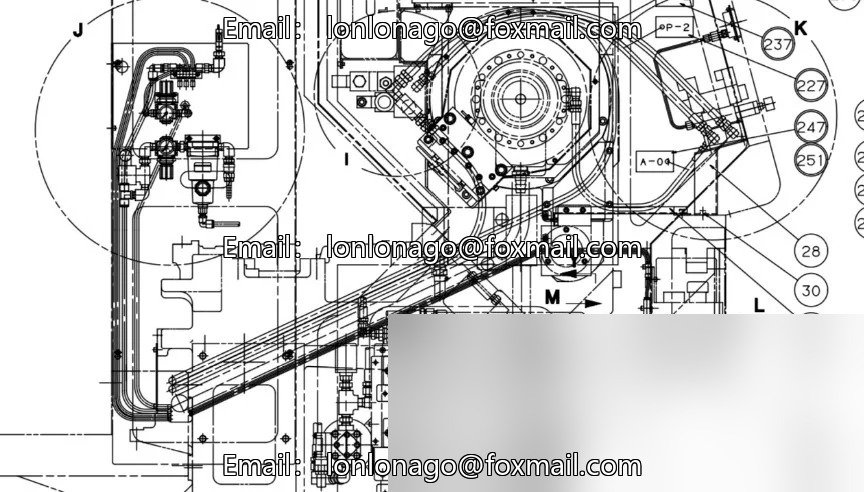
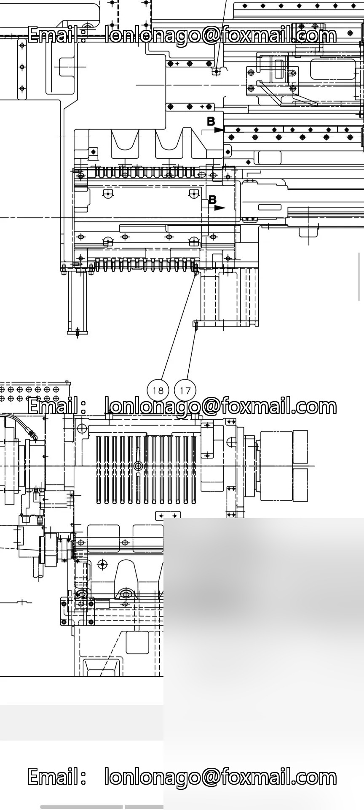
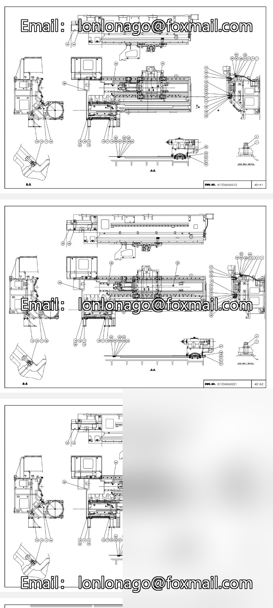
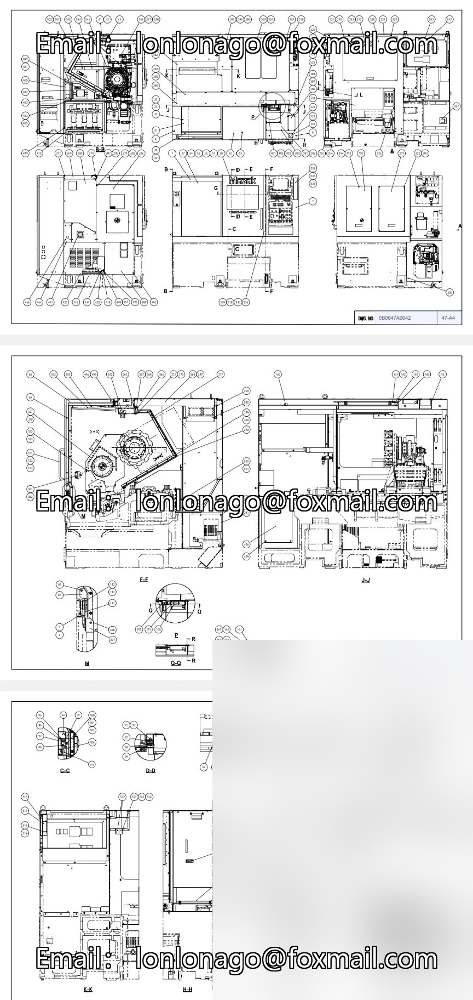
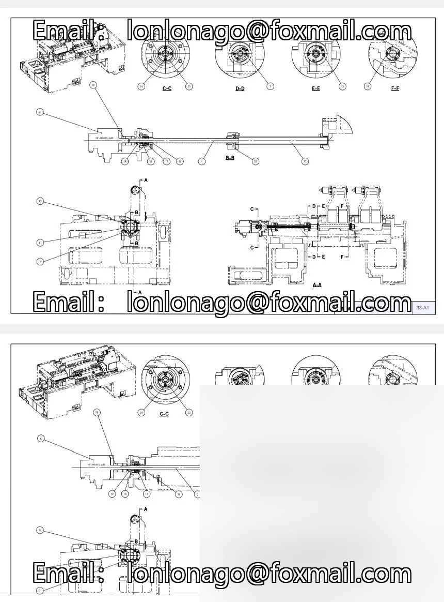

# Ma Zhak INTEGREX five-axis design assets

## Body

Mazak INTEGREX Five-Axis Design Material Mazak (Mazak) INTEGREX-300Y/400Y Five-Axis Vehicle Drilling-Sharpening Composite Machining Center Stock Manual PDF , both volumes 469.
INTEGREX series is Mazak's classic "multi-task processing" machine tool, integrating functions such as turning, milling, drilling, and tapping, capable of completing complex part processing with a single clamp, significantly improving efficiency.

05732
The Y-axis (horizontal offset), B-axis (turning angle milling head), and C-axis (spindle angle setting) work in coordination, supporting 5-face/5-axis linkage, and the dual spindle configuration (SECOND SPINDLE) is common on the 400Y model, suitable for automatic machining on both front and back faces.
non-refundable upon sale.

The material covers Mazak INTEGREX five-axis design content, including design details, drawing numbers and type identifiers.

<!-- AI_ENRICHED -->

## Images

## Payment

Here is a pay link on Stripe ( https://buy.stripe.com/3cs8yP7sY87d0vu9AB ). Please contact me lonlonago@foxmail.com after funding $89, and I will send you a complete data files , thank you!

